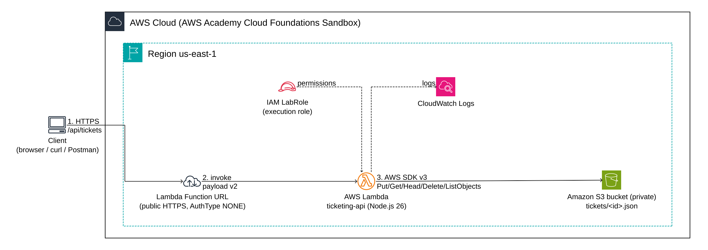

# event-ticketing-cc

Tugas individu Cloud Computing, Week 12 (Design & AWS Setup).
Rafif Raihan Bahrul Alam · 24/534432/TK/59237

API CRUD sederhana untuk tiket acara (tipe `regular` atau `vip`), dibangun dengan arsitektur
**Track C: Serverless** di AWS Academy Cloud Foundations Sandbox, region `us-east-1`.



## Arsitektur

```
Client (curl/Postman) --HTTPS--> Lambda Function URL --> AWS Lambda ticketing-api --> Amazon S3 (private)
                                                              |                         tickets/<id>.json
                                                              +-- IAM LabRole (execution role)
                                                              +-- CloudWatch Logs
```

| Komponen | Peran |
|---|---|
| Lambda Function URL | Endpoint HTTPS publik (auth type `NONE`, invoke mode `BUFFERED`) |
| AWS Lambda `ticketing-api` | Node.js 26.x. Routing, validasi, dan logika CRUD dalam satu fungsi |
| Amazon S3 `event-ticketing-534432` | Penyimpanan: satu objek JSON per tiket, key `tickets/<id>.json`. Block Public Access aktif, enkripsi SSE-S3 |
| IAM `LabRole` | Execution role Lambda. Memberi izin ke S3 dan CloudWatch Logs, jadi tidak ada access key di kode |
| CloudWatch Logs | Log eksekusi Lambda (`/aws/lambda/ticketing-api`) |

### Kenapa bukan API Gateway + Lambda + DynamoDB?

Contoh Track C di briefing tidak bisa dipakai utuh di lingkungan lab:

- Role lab `voclabs` tidak diizinkan `dynamodb:CreateTable`, baik di Sandbox maupun di environment
  Lab Project (bukti: `evidence/00a-dynamodb-denied.png`).
- Role lab juga ditolak membuat API di API Gateway (`apigateway:PUT`) di Sandbox
  (bukti: `evidence/00b-apigateway-denied.png`).
- Environment Lab Project tidak mengizinkan pembuatan fungsi Lambda.

Karena DynamoDB tidak bisa dipakai di Sandbox, penyimpanannya diganti dengan **Amazon S3**. Karena API Gateway
juga ditolak, endpoint HTTPS-nya memakai **Lambda Function URL**, dan keempat route diarahkan di dalam fungsi.

## Entitas: `Ticket`

| Atribut | Tipe | Aturan |
|---|---|---|
| `id` | string (UUID v4) | dibuat aplikasi (`crypto.randomUUID()`) |
| `buyer_name` | string | wajib, tidak boleh kosong atau hanya spasi; disimpan setelah di-trim |
| `type` | string | `regular` atau `vip`; default `regular` saat create |
| `price` | integer | bilangan bulat >= 0 |
| `created_at` | string (ISO 8601) | diisi aplikasi saat create, tidak berubah saat update |

## Endpoint

Base URL: Function URL, misalnya `https://<id>.lambda-url.us-east-1.on.aws`.

| Aksi | Method dan path | Body | Respons |
|---|---|---|---|
| Create | `POST /api/tickets` | `buyer_name`, `type` (opsional), `price` | `201` + tiket; `400` kalau tidak valid |
| Read (list) | `GET /api/tickets` | - | `200` + array tiket, terbaru di atas |
| Update | `PUT /api/tickets/{id}` | `buyer_name`, `type`, `price` | `200` + tiket baru; `400` tidak valid; `404` id tidak ada |
| Delete | `DELETE /api/tickets/{id}` | - | `204`; `404` id tidak ada |

Contoh:

```bash
URL=https://<id>.lambda-url.us-east-1.on.aws
curl -X POST $URL/api/tickets -H 'Content-Type: application/json' \
  -d '{"buyer_name":"Budi","type":"vip","price":250000}'
curl $URL/api/tickets
```

## Struktur repo

```
lambda/index.js            kode Lambda (handler CRUD)
scripts/test-crud.sh       tes 8 skenario CRUD lewat Function URL
docs/architecture.png      diagram arsitektur
docs/design-brief.pdf      design brief (2 halaman)
docs/deployment-plan.pdf   langkah deploy yang bisa diulang
evidence/                  screenshot dan output tes AWS
```

## Deploy dan tes

Langkah lengkap ada di [docs/deployment-plan.pdf](docs/deployment-plan.pdf). Ringkasnya:

1. Buat bucket S3 privat.
2. Buat Lambda `ticketing-api` (Node.js 26.x, role `LabRole`, Function URL auth `NONE`).
3. Tempel `lambda/index.js` sebagai `index.js`, set env `BUCKET_NAME`, timeout 10 detik.
4. Jalankan tes:

```bash
./scripts/test-crud.sh https://<id>.lambda-url.us-east-1.on.aws | tee evidence/06-curl-crud.txt
```

Skrip butuh `curl` dan `jq`.

## Status

- [x] Bucket S3, Lambda, dan Function URL ter-provision di `us-east-1`
- [x] Function test di console Lambda: POST 201, objek muncul di S3
- [x] Tes konektivitas lewat internet: **8 PASS, 0 FAIL** (`evidence/06-curl-crud.txt`)
- [ ] Autentikasi API (tahap berikutnya)

## Bukti AWS

| File | Isi |
|---|---|
| `evidence/00a-dynamodb-denied.png` | `dynamodb:CreateTable` ditolak untuk role lab |
| `evidence/00b-apigateway-denied.png` | `apigateway:PUT` (membuat API) ditolak untuk role lab |
| `evidence/01-s3-bucket.png` | bucket privat, Block all public access aktif |
| `evidence/02-lambda-config.png` | execution role `LabRole` dan resource policy Function URL |
| `evidence/03-lambda-test.png` | test event POST di console, status 201 |
| `evidence/04-s3-objects.png` | objek `tickets/<id>.json` tertulis oleh Lambda |
| `evidence/05-function-url.png` | Function URL, auth type `NONE` |
| `evidence/06-curl-crud.txt` | output tes CRUD lewat internet |
| `evidence/07-cloudwatch-log.png` | log eksekusi di CloudWatch |

## Batasan yang diketahui

- Tanpa autentikasi: siapa pun yang tahu URL bisa memanggil API.
- `GET` membaca semua objek di `tickets/` satu per satu. Cukup untuk data kecil, lambat untuk ribuan tiket.
- Tidak ada transaksi: kalau dua `PUT` ke tiket yang sama terjadi bersamaan, yang terakhir menang.
